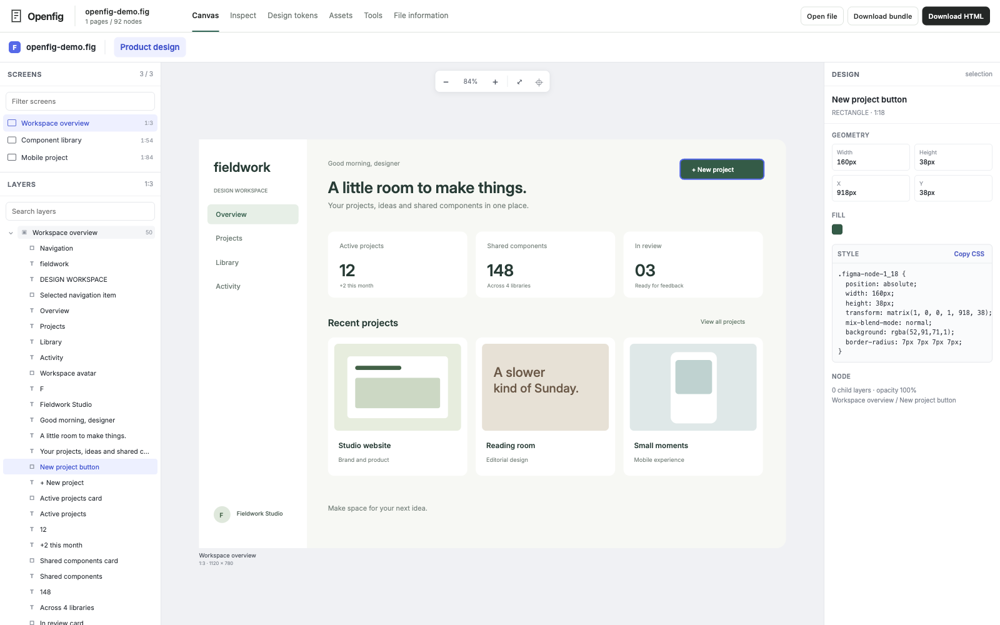
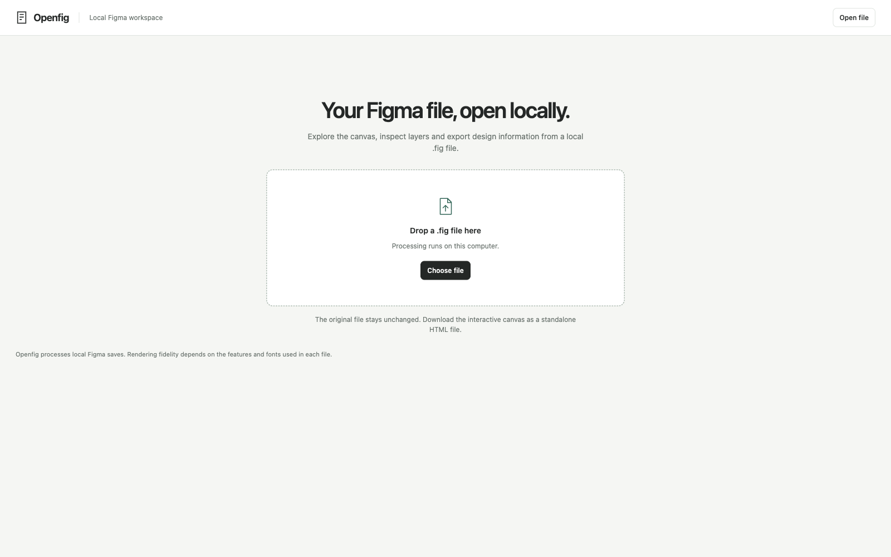

<!-- VERIFIED: usage grounded in package.json, scripts/dev.mjs, packages/openfig/src/cli.mjs, pipeline.mjs and server.mjs. -->

# Openfig

Open a local Figma `.fig` file in your browser. Explore its pages, select layers, inspect styles and copy them as CSS for web pages. Export the canvas as a standalone HTML file, or extract the design data for scripts and coding assistants.

Local file processing works without a Figma account.



## Run locally

You'll need Node.js 22 or newer, pnpm 11.6.0, Python 3 and Bun. Run these commands from the repository root:

```sh
python3 -m venv .venv
. .venv/bin/activate
python -m pip install -r requirements.txt
pnpm install --frozen-lockfile
bun dev
```

Open `http://127.0.0.1:8787` and drop a `.fig` file onto the page, or use **Open file**. The launcher builds the workspace before starting the app. Keep the Python environment active when starting Openfig so the renderer can use Pillow.

To try it with the demo shown above:

```sh
node scripts/create-demo.mjs --output .openfig/demo.fig
```

Open the generated file in the app. The generator requires a new output path.

<details>
<summary>File upload screen</summary>



</details>

## Explore a design

The **Canvas** view opens on the first screen. Pick another screen from the sidebar, search its layers, or select a component directly on the canvas. The Design panel shows its geometry, fills, typography and CSS.

Scroll to pan. Hold Ctrl or Command while scrolling to zoom around the pointer. Space plus drag also pans; double-click a component to focus it. Click empty canvas or press Escape to clear the selection.

The other views give you access to the extracted document:

| View | Use it for |
| --- | --- |
| Inspect | Search nodes and read their properties or subtree context. |
| Design tokens | Browse colors, typography, effects, required fonts and variables. |
| Assets | Preview and download extracted image assets. |
| Tools | Run document operations, attach reference images, compare PNGs or connect a coding assistant. |
| File information | Read the source fingerprint, parser metadata and document structure. |

**Download HTML** saves the interactive viewer with its embedded assets. **Download bundle** saves the extracted document and supporting files as a ZIP. Download either before stopping the server if you want to keep the result; uploaded sessions are temporary.

## Convert from the command line

After installation, build once if you haven't started the app:

```sh
pnpm build
```

Convert a design into an interactive HTML file:

```sh
pnpm run openfig -- convert ./design.fig --output ./design.html
```

Or extract its nodes, images, vectors, tokens, variables and saved text geometry:

```sh
pnpm run openfig -- extract ./design.fig --output ./.openfig/design
```

Conversion requires a new output file. Use `--force` to replace an existing export, or `--fonts ./fonts` to supply a font directory.

To start the app on a different port without rebuilding:

```sh
pnpm run openfig -- serve --port 8788
```

## Use the HTTP API

With the app running, send the raw `.fig` bytes to `/api/convert`. The response is the exported HTML:

```sh
curl --fail-with-body \
  --header 'content-type: application/fig' \
  --header 'x-filename: design.fig' \
  --data-binary @./design.fig \
  http://127.0.0.1:8787/api/convert \
  --output ./design.html
```

For repeated inspection, upload to `/api/documents` instead:

```sh
curl --fail-with-body \
  --header 'x-filename: design.fig' \
  --data-binary @./design.fig \
  http://127.0.0.1:8787/api/documents \
  --output ./document.json
```

The JSON response includes a document `id` and URLs for its preview, downloads, metadata and assistant connection. Use that ID in the routes below:

| Request | Result |
| --- | --- |
| `GET /api/documents/:id/nodes?query=Button` | Search node names and text. |
| `GET /api/documents/:id/nodes?reference=1:18` | Inspect a node by ID. |
| `GET /api/documents/:id/tokens` | Read design tokens and variables. |
| `GET /api/documents/:id/assets` | List extracted images and their download URLs. |
| `GET /api/documents/:id/bundle` | Download the extracted bundle. |
| `DELETE /api/documents/:id` | Remove the temporary document session. |
| `GET /api/tools` | Discover supported operations, arguments and routes. |

The default server listens on loopback and has no user authentication. Keep it local unless you provide access controls. Uploads are limited to 1 GiB by default; set `OPENFIG_MAX_UPLOAD_BYTES` to change that limit.

## Connect a coding assistant

Openfig supports the Model Context Protocol (MCP), which lets coding assistants call tools against a design. Local tools can search layers, inspect components, read tokens, retrieve assets, export vector groups and compare a candidate image with an attached reference.

For an uploaded file, open **Tools**, then **Connect with MCP**. Copy the document's connection configuration into your MCP client. It uses the same port as the app.

For an extracted bundle, start a server over standard input and output:

```sh
node packages/openfig/src/cli.mjs mcp --root ./.openfig/design
```

Saved-file tools work locally. Live Figma selections, account libraries and writes to Figma use its authenticated service. The [MCP guide](docs/FIGMA-MCP.md) covers client setup and the local and hosted tool catalogs.

## Fonts and rendering

Openfig uses saved glyph outlines when they're available. Text that falls back to browser rendering needs the corresponding fonts for matching shape and wrapping. Copied CSS also needs those fonts in the application where you use it.

To embed fonts in an export, place licensed font files and a `manifest.json` in a font directory, then pass `--fonts` when starting the app or converting a file:

```sh
bun dev --fonts ./fonts
pnpm run openfig -- convert ./design.fig --output ./design.html --fonts ./fonts
```

The manifest lists each font's family, file, style and weight. See the [example manifest](packages/openfig/fonts/manifest.example.json). The default directory, `packages/openfig/fonts/local/`, is excluded from Git. The demo screenshots use Inter, so fallback text can look different on a fresh checkout.

Rendering can differ from Figma, including text, image sampling and effects. Check the screens that matter against the original design. The [fidelity guide](docs/FIDELITY.md) explains the comparison method and known limits.

The parser accepts `fig-kiwi` streams, either bare or inside a `.fig` ZIP containing `canvas.fig`. Other variants, `.jam` and `.deck` files are unsupported. Bare streams lack the ZIP's separate image files, so referenced images may be unavailable.

## How it works

The core parser decodes the file's embedded schema into a document tree. The conversion pipeline resolves component instances, saved overrides, variable colors and geometry, then assembles selectable vector layers into one HTML viewer.

| Directory | Role |
| --- | --- |
| `packages/core` | File decoding, normalized bundles, tokens and visual comparison. |
| `packages/cli` | Extraction and inspection commands. |
| `packages/mcp-server` | Design tools for coding assistants. |
| `packages/openfig` | Renderer, browser app and HTTP API. |

[Conversion process](docs/PROCESS.md) records the implementation and rendering corrections. [Third-party notices](THIRD-PARTY-NOTICES.md) lists the bundled code and font licenses, including the `figctx` parser and Grida runtime.
